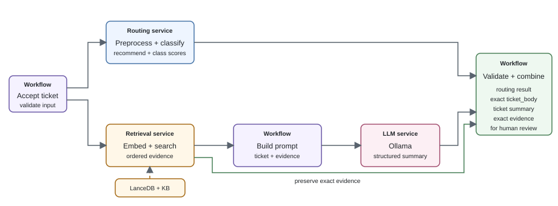

# Homework 6 - Build the Ticket-Preparation Workflow

## Goal

Turn the routing, retrieval, and local-LLM work from earlier homeworks into a
complete ticket-preparation application. Place each component behind an
independently callable service, connect them according to the supplied workflow
contract and diagram, preserve the exact submitted ticket body in every
successful review package and add correlated tracing.

## Provided Materials

| Material | Purpose |
| --- | --- |
| `WORKFLOW_CONTRACT.md` | Required workflow request, response, statuses, and failure behavior |
| `workflow_services.svg` | Diagram of the required workflow and service responsibilities |
| `parallelism_example.py` | Example of running two tasks concurrently with `ThreadPoolExecutor` |
| `trace_logger.py` | Structured JSONL logging, trace-ID generation, event recording, and trace lookup |
| `test_trace_logger.py` | Basic tests for the supplied trace logger |
| `requirements.txt` | Cumulative pinned dependencies through Homework 6 |

## System Workflow

The diagram below shows the required system we will be implementing as a workflow in this homework.



For successful processing, the workflow response must include the exact request
`Body` as `ticket_body`, preserving case and whitespace.

In this homework, implement the services and workflow as Python classes in one
application. The workflow calls service methods directly; do not build HTTP APIs
or containers yet. The LLM service calls the existing Ollama API. In Homework 7,
you will put HTTP APIs around routing and retrieval and run the components in
separate containers.

## Task 1 - Define the Service Contracts

Before building the components, define the input and output contract for each
of the three services: routing, retrieval, and LLM.

### Requirements

For each of the three services:
- Define the input request shape, fields, types, and optionality.
- Define the output response shape, fields, types, and optionality.
- Define how errors are surfaced (e.g. invalid requests, internal errors)

The routing response must preserve the classifier's `recommended_department` and
`class_scores`.

### Deliverables

- For each service, a separate contract doc containing:
  - One request schema.
  - One response schema.
  - A brief description of error handling and failure behavior.

## Task 2 - Build the Routing Service

Convert the routing model from homework 4 into a standalone service.

### Requirements

- Use the classifier (cleaning, preprocessing, model) you selected in homework 4.
- Create a `routing_service.py` file containing a `RoutingService` class with a
  `route_ticket` method
  that validates input and invokes the classifier.
- Preserve `recommended_department` and `class_scores` in the response.
- Ensure `route_ticket` adheres to the task 1 input/output contracts.
- Load the classifier in `__init__` and reuse it across requests.
- Surface failures; don't just return a default value.

### Deliverables

- `routing_service.py`

## Task 3 - Build the Retrieval Service

Convert the retrieval system from homework 5 into a standalone service.

### Requirements

- Use the `VectorStore`, persisted vector store, and selected retrieval count from
  homework 5.
- Create a `retrieval_service.py` file containing a `RetrievalService` class with a
  `retrieve_evidence` method
  that validates input and invokes the retriever.
- Ensure `retrieve_evidence` adheres to the task 1 input/output contracts.
- In `__init__`, open the existing vector store and store the selected retrieval
  count. Reuse them across requests; do not rebuild the index per request.
- Surface failures; don't just return an empty result.

### Deliverables

- `retrieval_service.py`

## Task 4 - Build the LLM Service

Convert the local-model interaction from homework 5 into a standalone service.
To be clear, this is an LLM-Service that responds to any prompt/params, and is 
not restricted to only summarization. The workflow decides how to use the LLM-service.

### Requirements

- Create an `llm_service.py` file containing an `LLMClient` class with a `call_llm` method
  that validates input and invokes the LLM.
- In `__init__`, store the Ollama URL. This class calls Ollama; it does not
  load the LLM into Python.
- Ensure `call_llm` adheres to the task 1 input/output contracts.
- Pass the prompt, model, generation settings, and any output schema into
  `call_llm` on each call; do not fix them in the service.
- Surface failures; don't return a default value.

### Deliverables

- `llm_service.py`

## Task 5 - Build the Workflow

Connect the routing, retrieval, and LLM services into the workflow shown
above.

### Requirements

- Create a `workflow.py` file containing a `TicketWorkflow` class with a
  `process_ticket` method.
- Have `TicketWorkflow.__init__` instantiate each of the required services and 
  store them for reuse across requests.
- Generate a unique `workflow_record_id` when `process_ticket` begins. Include it
  in every result, and do not accept it from the client.
- `process_ticket` should implement the workflow diagram above. This includes ensuring
  that routing path and full summarization path are independent and run in parallel. 
  The provided `parallelism_example.py` gives an example of running 2 tasks concurrently.
- `process_ticket` should adhere to the provided `WORKFLOW_CONTRACT.md`.
- The workflow should handle prompt-construction based on homework 5's prompt-with-RAG,
  even if using RAG made your results worse.
- Pass the Homework 5 model, generation settings, and ticket-summary output
  schema to the LLM service along with the constructed prompt.
- Implement validations on the response from each service; handle failures according to the Task
  1 contracts.
- Surface failures; don't return a default value.

### Deliverables

- None; you'll submit the completed `workflow.py` in Task 6.

## Task 6 - Add Logging/Tracing

Use the supplied `trace_logger.py` to add structured tracing to the workflow.

### Requirements

- Interact with logging exclusively through `TraceLogger`.
- Create one `TraceLogger` inside `TicketWorkflow.__init__` and reuse it across
  requests.
- Generate one `trace_id` when `process_ticket` begins.
- Use that `trace_id` for every log record created during the request.
- Record workflow start, completion, and terminal status.
- Record `started` and `completed` or `failed` around each service call.
- Record elapsed time for each service and the complete workflow.
- Record the recommended department from the routing service.
- Record retrieved chunk IDs from the retrieval service.
- Include the `trace_id` in the workflow response as described by `WORKFLOW_CONTRACT.md`.
- Do not log ticket text, `ticket_body`, prompts, retrieved content, generated
  summaries, credentials, or hidden model reasoning. This can expose sensitive
  information.

### Deliverables

- `workflow.py` with tracing.

## Submission Guidelines

- Submit the complete homework as one `.zip` file. Do not submit individual
  files or multiple `.zip` files.
- Name the archive `Firstname_Lastname_HW6.zip`, using the same first and last
  name shown in Google Classroom. For example: `Tanner_Gilligan_HW6.zip`.
- Organize the archive with one folder per task at its root. Each task folder
  should contain that task's deliverables:

  ```text
  Tanner_Gilligan_HW6.zip
  ├── Task1/
  ├── Task2/
  ├── Task3/
  ├── Task4/
  ├── Task5/
  └── Task6/
  ``` 

- Upload the `.zip` file itself. Do not submit a Google Drive, GitHub, or other
  external link in place of the file.
- Submit data tables as static CSV files, not Excel files or links to Google
  Sheets.
- Submit writeups as `.txt` or `.md` files.
- Do not include duplicate or extraneous files unless they are relevant to
  running or interpreting your submission.
